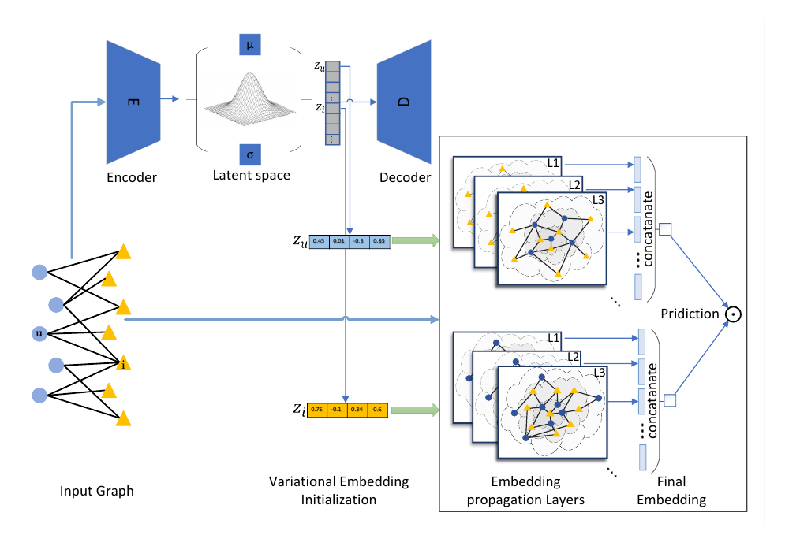

# GVECF: Neural Graph Collaborative Filtering Using Variational Inference

[](https://arxiv.org/abs/2311.11824)


[](LICENSE)

PyTorch implementation of **GVECF** (Graph Variational Embedding Collaborative Filtering), from the paper

> **Neural Graph Collaborative Filtering Using Variational Inference**
> Narges Sadat Fazeli Dehkordi, Hadi Zare, Parham Moradi, Mahdi Jalili
> arXiv:2311.11824, 2023 — [paper](https://arxiv.org/abs/2311.11824)

GNN-based recommenders such as NGCF start from randomly initialised (Xavier) user and item embeddings, so the user-item interactions play no part in the embeddings before propagation. GVECF instead **pre-trains a variational graph auto-encoder (VGAE)** on the user-item graph and uses its latent **variational embeddings (VEs)** as the initial embeddings of NGCF. This gives the recommender a head start, improves Recall@20 by up to **13.78%** on the sparse Amazon-Book dataset, and reaches NGCF's best accuracy in far fewer epochs.

<p align="center">
  
</p>

## How it works

1. **Variational embedding (pre-training).** A 3-layer GCN encoder maps every user and item node of the bipartite graph to a Gaussian `q(z | X, A) = N(μ, diag(σ²))`; an inner-product decoder `σ(z_uᵀ z_i)` reconstructs the interactions. The model is trained on the negative ELBO (reconstruction + KL to `N(0, I)`).
2. **Embedding propagation.** The VEs become `Z⁽⁰⁾` of NGCF, which refines them over `L` layers:
   `Z⁽ˡ⁾ = LeakyReLU((𝓛 + I) Z⁽ˡ⁻¹⁾ W₁ + (𝓛 Z⁽ˡ⁻¹⁾ ⊙ Z⁽ˡ⁻¹⁾) W₂)`, with `𝓛 = D^{-1/2} A D^{-1/2}`.
3. **Prediction.** Layer outputs are concatenated, `e* = e⁽⁰⁾ ‖ … ‖ e⁽ᴸ⁾`, and scored with `ŷ(u, i) = e*_uᵀ e*_i`, trained with the BPR loss.

## Results

Top-20 recommendation performance reported in the paper:

| Method | Gowalla Recall | Gowalla NDCG | Yelp2018 Recall | Yelp2018 NDCG | Amazon-Book Recall | Amazon-Book NDCG |
|---|---|---|---|---|---|---|
| MF | 0.1291 | 0.1109 | 0.0433 | 0.0354 | 0.0250 | 0.0196 |
| NCF | 0.1399 | 0.1212 | 0.0451 | 0.0363 | 0.0258 | 0.0200 |
| HOP-Rec | 0.1399 | 0.1214 | 0.0517 | 0.0428 | 0.0309 | 0.0232 |
| NGCF | 0.1555 | 0.1324 | 0.0548 | 0.0448 | 0.03155 | 0.02414 |
| **GVECF** | **0.1578** | **0.1353** | **0.0566** | **0.0463** | **0.0359** | **0.0273** |
| Improvement | 1.47% | 2.22% | 3.15% | 3.28% | 13.78% | 13.09% |

Ablation on the initial embeddings (Table 3 of the paper):

| Initialisation | Gowalla Recall | Yelp2018 Recall | Amazon-Book Recall |
|---|---|---|---|
| Xavier (NGCF) | 0.1555 | 0.0549 | 0.03155 |
| GAE embeddings | 0.1571 | 0.0564 | 0.0318 |
| **VGAE embeddings (GVECF)** | **0.1578** | **0.0566** | **0.0359** |

GVECF also reaches NGCF's best Recall in 219 / 209 / 115 epochs instead of 400 / 400 / 130 on Gowalla / Yelp2018 / Amazon-Book.

## Installation

```bash
git clone https://github.com/Narges-fazeli/GVECF.git
cd GVECF
pip install -r requirements.txt
```

Install the PyTorch build that matches your CUDA version from [pytorch.org](https://pytorch.org/get-started/locally/). Everything also runs on CPU, just more slowly.

## Data

The code reads the NGCF / LightGCN format: a folder per dataset with `train.txt` and `test.txt`, where every line is `user_id item_id item_id ...` (0-based ids). See [`data/README.md`](data/README.md) for where to download Gowalla, Yelp2018 and Amazon-Book.

| Dataset | #Users | #Items | #Interactions | Density |
|---|---|---|---|---|
| Gowalla | 29,858 | 40,981 | 1,027,370 | 0.00084 |
| Yelp2018 | 31,668 | 38,048 | 1,561,406 | 0.00130 |
| Amazon-Book | 52,643 | 91,599 | 2,984,108 | 0.00062 |

## Quick start (toy data, about one minute on CPU)

```bash
python scripts/make_toy_data.py                       # writes data/toy/
python pretrain_vgae.py --dataset toy --epochs 30 --batch_size 2048
python train.py --dataset toy --epochs 60 --lr 1e-3   # NGCF baseline
python train.py --dataset toy --epochs 60 --lr 1e-3 \
    --pretrained embeddings/toy_vgae_d64.npz          # GVECF
```

## Reproducing the experiments

```bash
# 1) Pre-train the variational embeddings (and the GAE ablation)
python pretrain_vgae.py --dataset gowalla --model vgae --embed_size 64
python pretrain_vgae.py --dataset gowalla --model gae  --embed_size 64

# 2) Train the baseline and GVECF
python train.py --dataset gowalla                                                # NGCF (Xavier)
python train.py --dataset gowalla --pretrained embeddings/gowalla_vgae_d64.npz  # GVECF
python train.py --dataset gowalla --pretrained embeddings/gowalla_gae_d64.npz   # GVECF-GAE

# 3) Plot NDCG-vs-epoch and time-vs-recall curves (Figs. 2 and 4)
python scripts/plot_curves.py runs/gowalla_ngcf_* runs/gowalla_gvecf_vgae_* \
    --labels NGCF GVECF --out figures/gowalla.png
```

`run_experiments.sh` runs the full pipeline on all three datasets.

**Settings used in the paper:** embedding size 64, 3 propagation layers of size 64, batch size 1024, BPR loss, message dropout 0.1, up to 400 epochs with evaluation every 10 epochs. The VGAE uses a 3-layer GCN with learning rate 0.01. The learning rate, L2 strength and node dropout were selected by grid search over

| Hyper-parameter | Values |
|---|---|
| `--lr` | 5e-4, 1e-4, 5e-5, 1e-5, 5e-6 |
| `--reg` | 5e-4, 1e-5, 1e-6 |
| `--node_dropout` | 0.1, 0.2 |

Each run is saved in `runs/<dataset>_<method>_<time>/` with `config.json`, `log.csv` (loss, Recall@K and NDCG@K at each evaluation, plus elapsed time), `train.log`, the best checkpoint `best.pt` and `results.json`.

### Main options

| Script | Option | Meaning |
|---|---|---|
| `pretrain_vgae.py` | `--model {vgae,gae}` | variational or plain graph auto-encoder |
| | `--embed_size` | size of the VEs (must match `train.py`) |
| | `--n_layers`, `--hidden_size` | GCN encoder depth and width |
| | `--kl_weight` | weight of the KL term (default `1 / #nodes`) |
| `train.py` | `--pretrained FILE` | initialise from VEs; omit for the NGCF baseline |
| | `--ve_mode {mu,sample}` | use the posterior mean or one sample `μ + σ·ε` |
| | `--layer_size`, `--mess_dropout` | propagation layers and their dropout |
| | `--Ks` | cut-offs for Recall@K / NDCG@K (default 20) |

## Implementation notes

- Users and items have no side features, so the VGAE input is the identity matrix and its first GCN layer is a learnable node-embedding table.
- The full `(N+M)²` reconstruction does not fit in memory, so the decoder loss uses the observed user-item edges and the same number of sampled non-interacted pairs.
- Evaluation ranks all items for each test user, excludes training items, and averages Recall@K and NDCG@K over test users (NDCG normalised by the ideal ranking of the user's test items).

## Repository structure

```
GVECF/
├── gvecf/
│   ├── data.py          # dataset loading, bipartite graph, normalised Laplacian, BPR sampling
│   ├── vgae.py          # VGAE / GAE encoder-decoder (variational embeddings)
│   ├── ngcf.py          # NGCF propagation with optional VE initialisation
│   ├── metrics.py       # Recall@K, NDCG@K
│   └── utils.py
├── pretrain_vgae.py     # step 1: pre-train and export VEs
├── train.py             # step 2: train NGCF / GVECF
├── run_experiments.sh   # full pipeline on all datasets
├── scripts/
│   ├── make_toy_data.py
│   └── plot_curves.py
├── data/                # datasets (not tracked, see data/README.md)
└── assets/architecture.png
```

## Citation

If you find this work useful, please cite:

```bibtex
@article{fazelidehkordi2023gvecf,
  title   = {Neural Graph Collaborative Filtering Using Variational Inference},
  author  = {Fazeli Dehkordi, Narges Sadat and Zare, Hadi and Moradi, Parham and Jalili, Mahdi},
  journal = {arXiv preprint arXiv:2311.11824},
  year    = {2023}
}
```

## Acknowledgements

This work builds on [NGCF](https://github.com/xiangwang1223/neural_graph_collaborative_filtering) (Wang et al., SIGIR 2019) and the variational graph auto-encoder (Kipf & Welling, 2016). The benchmark datasets are the versions released with NGCF and LightGCN.

## License

Released under the [MIT License](LICENSE).
